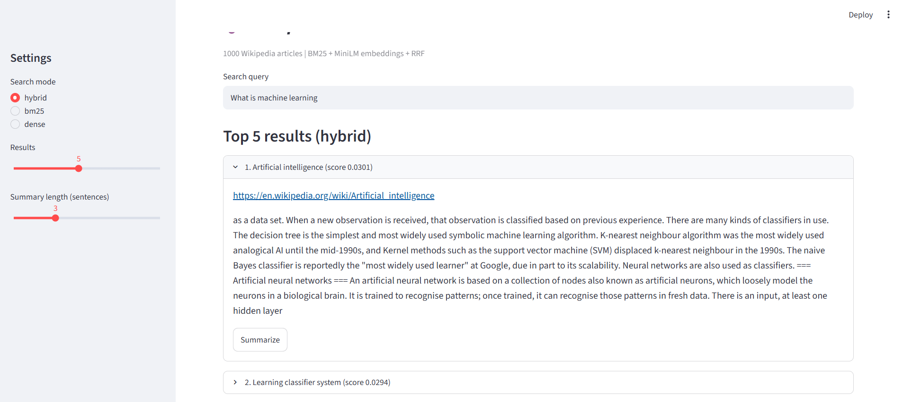
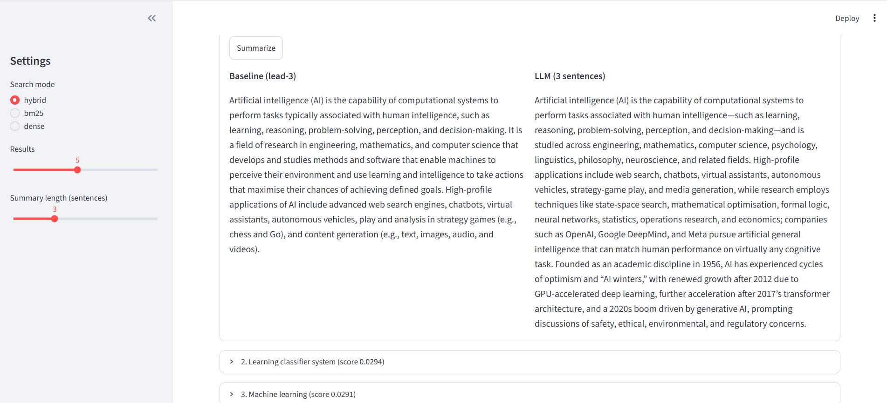
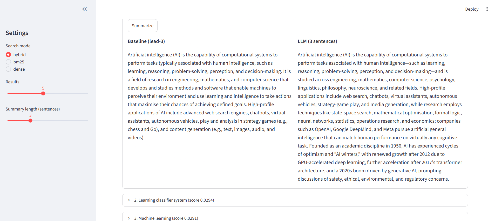

# Task 5 Report: Document Search + Summarization

## 1. Overview

A search and summarization system over a 1000-article AI/ML Wikipedia corpus:

- **Search:** BM25 + MiniLM (all-MiniLM-L6-v2) chunk embeddings, fused with Reciprocal Rank Fusion (RRF).
- **Summarization:** lead-N extractive baseline vs LLM abstractive summaries (Groq, openai/gpt-oss-120b). The user chooses the summary length (1-8 sentences).
- **Evaluation:** Hit@5 / MRR for search; ROUGE and a blind human A/B test for summaries.
- **UI:** Streamlit app (`app.py`) with search mode, number of results and summary length controls.

## 2. Data Preparation

### 2.1 Corpus

English Wikipedia, AI/ML topics only, collected through the Wikipedia API (`collect_data.py`):

- Articles from 8 root categories (Machine learning, Artificial intelligence, Deep learning, Natural language processing, Computer vision, Artificial neural networks, Reinforcement learning, Large language models), including up to 15 subcategories per category.
- A list of 43 seed titles (core topics such as Backpropagation, Gradient descent, Support vector machine) added explicitly, so that the main concepts are always in the corpus.
- Articles shorter than 500 characters are dropped (stubs and redirects have no useful content). The corpus is capped at 1000 articles.
- Each document is stored as `id, title, url, text` in `data/documents.json`.

Justification: a single-domain corpus keeps search evaluation meaningful (queries have clear expected articles), and Wikipedia gives long, well-structured text suitable for both search and summarization.

### 2.2 Cleaning

Wikipedia text contains LaTeX math markup (for example `{\displaystyle ...}`) that adds noise to summaries and snippets. `clean_text()` in `summarize.py`:

- removes `{\displaystyle ...}` blocks (including nested braces) and leftover LaTeX commands,
- removes empty brackets and parentheses left behind,
- normalizes whitespace and stray spaces before punctuation.

The cleaned text is used for summarization. The effect on ROUGE is described in section 4.1.

### 2.3 Chunking

For embeddings, each article is split into 150-word chunks with a 120-word step (30-word overlap), so a long article is not squeezed into one vector and a topic that appears in the middle of an article can still be found.

## 3. Methodology

### 3.1 Search

1. **BM25** (`rank_bm25`) over title + full text of each article. Strong on exact keywords.
2. **Dense retrieval:** all-MiniLM-L6-v2 embeddings of every chunk (normalized), cosine similarity with the query. The best chunk per article gives the article rank and the result snippet. Embeddings are computed once and cached in `data/chunk_embeddings.npy`.
3. **Hybrid:** Reciprocal Rank Fusion with k=60 over the top 50 candidates of both rankings. RRF needs no score normalization between BM25 and cosine similarity.

The top N results (N set by the user) are returned with title, URL, score and best-matching excerpt.

### 3.2 Summarization

- **Baseline:** lead-N, the first N sentences of the cleaned article.
- **LLM:** the cleaned article (truncated to the first 12,000 characters) is sent to the LLM with a prompt asking for an N-sentence plain-text summary. The same N is used for the baseline in the UI, so both are compared at equal length.
- Provider and model come from `.env` (`llm.py`), so the provider can be swapped without code changes.

## 4. Evaluation

### 4.1 Search

Test set: 30 queries, each written to describe one expected article without naming it (for example "model memorizes training data and fails on new data" -> Overfitting). A query counts as a hit if the expected article is in the top 5.

| Mode | Hit@5 | MRR |
|---|---|---|
| BM25 | 0.767 | 0.510 |
| Dense | 0.800 | 0.558 |
| Hybrid (RRF) | 0.867 | 0.611 |

Hybrid is best on both metrics: +10 points Hit@5 over BM25 and +6.7 over dense. BM25 catches exact keyword matches, dense retrieval catches paraphrases, and RRF combines the two rankings.

**Observed weakness:** for the broad query "supervised learning", the top hybrid result was "Representation learning" instead of the "Supervised learning" article. Broad topic queries match many related articles that use the term heavily, and chunk-level retrieval can favor a keyword-dense chunk over the article that is actually about the topic.

### 4.2 Summaries: ROUGE

20 documents, the article's intro paragraph as reference.

| Method | ROUGE-1 | ROUGE-2 | ROUGE-L |
|---|---|---|---|
| Lead-3 baseline | 0.274 | 0.066 | 0.155 |
| LLM | 0.305 | 0.051 | 0.153 |

Before LaTeX cleaning the numbers were 0.264 / 0.060 / 0.149 (baseline) and 0.308 / 0.056 / 0.154 (LLM). Cleaning helped the baseline in all three metrics, because lead-3 copies the noisy text directly.

The LLM is higher on ROUGE-1, lower on ROUGE-2, and tied on ROUGE-L. The reference is the article's own intro, and lead-3 copies the first sentences of the same text, so lead-3 has a built-in advantage in exact bigram overlap. The LLM paraphrases, which lowers exact n-gram matches even when the content is good. ROUGE alone therefore understates the LLM.

### 4.3 Summaries: human evaluation

10 documents, blind A/B (positions randomly shuffled, key stored in a separate file), 1-5 rating for accuracy and coverage of the main point.

| Method | Average rating |
|---|---|
| Lead-3 baseline | 4.60 |
| LLM | 4.80 |

Per-document comparison: LLM won 2, baseline won 1, tied 7.

The LLM has a slight edge, but with only 10 samples and 7 ties the difference is not statistically meaningful. The LLM helped most on articles whose opening sentences do not state the main topic (for example WaveNet, where lead-3 only covered text-to-speech background). Lead-3 does well when the opening paragraph is already a good summary.

## 5. Challenges and Solutions

| Challenge | Solution |
|---|---|
| LaTeX markup in Wikipedia text made summaries and snippets noisy | Added `clean_text()` with brace-aware removal; baseline ROUGE improved on all metrics |
| Some expected articles for test queries were missing from the corpus (category crawling alone does not guarantee core topics) | Added a seed title list so the main concepts are always collected; Hit@5 and MRR are measured only on queries whose expected article is in the corpus |
| Gemini free-tier daily quota ran out during evaluation | `llm.py` supports multiple providers through `.env`; switched to Groq (openai/gpt-oss-120b) |
| ROUGE favors extractive summaries when the intro is the reference | Added a blind human A/B evaluation and discussed the bias |
| Human evaluation sheet could not be rated reliably in a spreadsheet | Wrote `rate_human_eval.py` to rate in the terminal and compute averages with the hidden key |
| Large generated data (embeddings, corpus) should not live in git | `data/` is git-ignored; `collect_data.py` regenerates the corpus and the embedding cache is rebuilt on first run |

## 6. Scalability and Efficiency

- Chunk embeddings are computed once and cached, so startup after the first run only loads a `.npy` file.
- The Streamlit app loads the search index once (`@st.cache_resource`), and LLM summaries are cached per document and length (`@st.cache_data`).
- Dense search is a single matrix-vector product over all chunks, which is fine for thousands of documents. For millions of chunks, the next step would be an approximate nearest neighbor index (FAISS or HNSW) and an inverted-index BM25 engine.

## 7. Limitations

- **Text cleaning gaps:** removing LaTeX leaves broken phrases such as "is where is an increasing function", which hurts both methods.
- **Reference choice:** using the intro paragraph as reference favors extractive methods under ROUGE.
- **Small human eval:** 10 documents, one rater, so no inter-rater agreement and low statistical power.
- **Small query set:** 30 queries, one expected article each, so related-but-valid results count as misses.
- **Chunk snippets:** snippets can start mid-sentence and contain Wikipedia markup (`== Heading ==`).
- **LLM dependency:** LLM summaries need an API key and are rate-limited on free tiers.
- **No fine-tuning:** the LLM and embedding model are used as they are.

## 8. Possible Improvements

- Strip Wikipedia section markup from snippets.
- Add a cross-encoder reranker on the top 20 hybrid results.
- Boost exact title matches for short broad queries.
- Add pagination and query auto-suggestion to the UI.
- Evaluate summaries with additional metrics (BERTScore) and more human raters.

## 9. Screenshots

| Search results | Summaries side by side | Search modes |
|---|---|---|
|  |  |  |