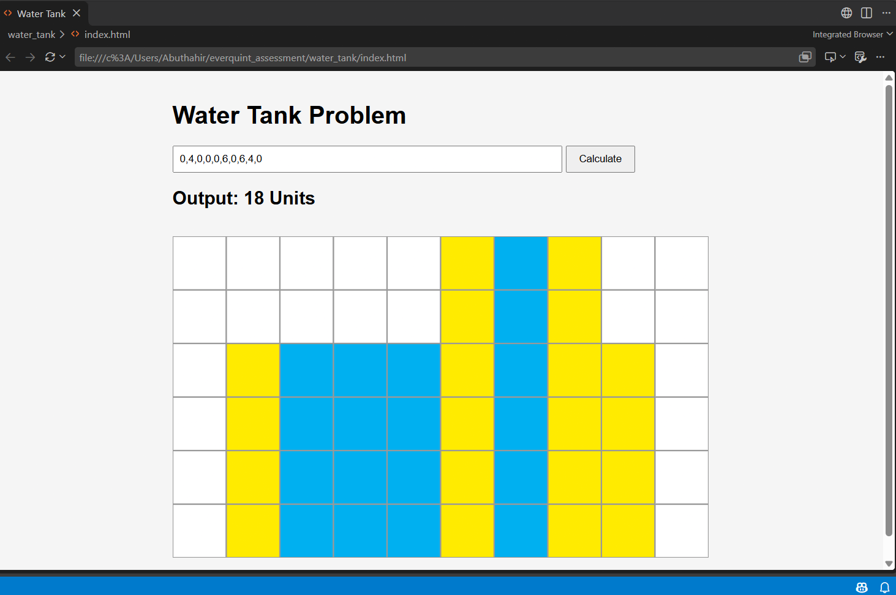

# Water Tank Problem

Given an array of non-negative block heights, compute the units of water trapped between the blocks and visualize the result as an SVG grid.

**Example:** `[0,4,0,0,0,6,0,6,4,0]` -> **18 Units**

## Approach
Water above a block = min(highest block on its left, highest block on its right) - its own height.

1. `leftMax[i]`: highest block from the left up to index i
2. `rightMax[i]`: highest block from the right up to index i
3. `water[i] = min(leftMax[i], rightMax[i]) - height[i]`; total = sum of all `water[i]`

Time: O(n), space: O(n).

## Visualization
SVG grid: yellow = block, blue = water, white = empty.

## Input validation
Only whole numbers (0 or more) separated by commas are accepted. Anything else shows an error message.

## How to run
Open `index.html` in any browser, enter heights separated by commas and click Calculate.

## Files
- `index.html` - page structure
- `style.css` - styling
- `script.js` - algorithm, validation and SVG drawing

Built with Vanilla JavaScript, HTML and CSS (no libraries).